# TPs Machine Learning : KNN (Iris), Régression linéaire (Airbnb NYC), Kohonen SOM, Régression logistique

| TP | Notebook | Résultat principal |
|----|----------|--------------------|
| TP1 : classification des iris avec KNN | [`tp1_knn_iris/TP1_KNN_class_flor_iris.ipynb`](tp1_knn_iris/TP1_KNN_class_flor_iris.ipynb) | Exactitude sur le jeu de test = **0.97** (k = 1) ; `[5, 2.9, 1, 0.2]` est prédite **setosa** |
| TP2 : régression linéaire, prix Airbnb à Brooklyn | [`tp2_regression_lineaire/TP2_Regression_Lineaire.ipynb`](tp2_regression_lineaire/TP2_Regression_Lineaire.ipynb) | Régression simple : a = 0.00068, b = 4.55 (≈ 95 $) ; régression multiple : MAE = 62.85 $, RMSE = 155.53 $ |
| TP3 : cartes de Kohonen (SOM), exécuté dans Anaconda + Jupyter sous Docker | [`tp3_kohonen_som/notebooks/TP3_Kohonen_SOM.ipynb`](tp3_kohonen_som/notebooks/TP3_Kohonen_SOM.ipynb) ([README](tp3_kohonen_som/README.md)) | Carte 15×15 entraînée ; erreur de quantification = **0.2126** |
| TP4 : régression logistique, cancer du sein (Kaggle), Anaconda + Jupyter sous Docker | [`tp4_regression_logistique/notebooks/TP4_Regression_Logistique.ipynb`](tp4_regression_logistique/notebooks/TP4_Regression_Logistique.ipynb) ([README](tp4_regression_logistique/README.md)) | Exactitude sur le test = **0.965**, AUC = **0.996** |

Chaque dossier contient aussi l'export HTML du notebook exécuté.

📘 **Pour tout refaire à la main, étape par étape (Anaconda + Jupyter, sans Docker) : [GUIDE_MANUEL.md](GUIDE_MANUEL.md)**

## Exécution

```bash
pip install -r requirements.txt
cd tp1_knn_iris && jupyter notebook TP1_KNN_class_flor_iris.ipynb
cd tp2_regression_lineaire && jupyter notebook TP2_Regression_Lineaire.ipynb
```

Le jeu de données `AB_NYC_2019.csv` (Kaggle, *New York City Airbnb Open Data*) est fourni dans `tp2_regression_lineaire/data/`.

## Captures d'écran (exécution réelle)

### TP1 : KNN Iris
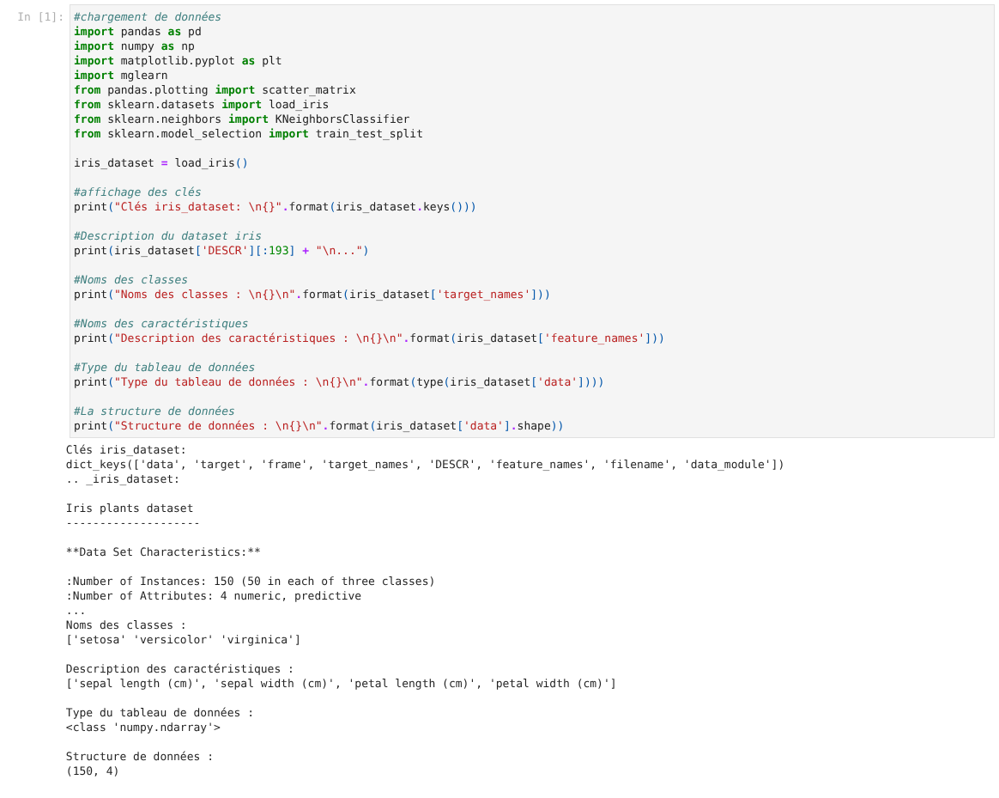
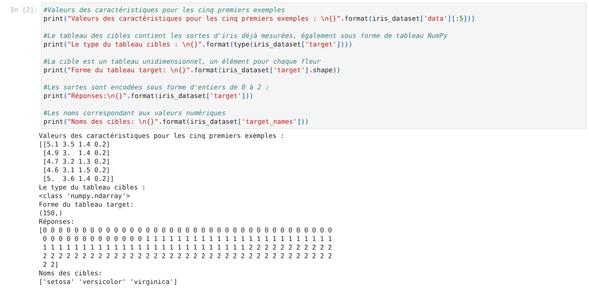
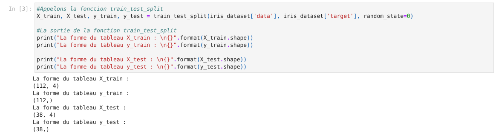
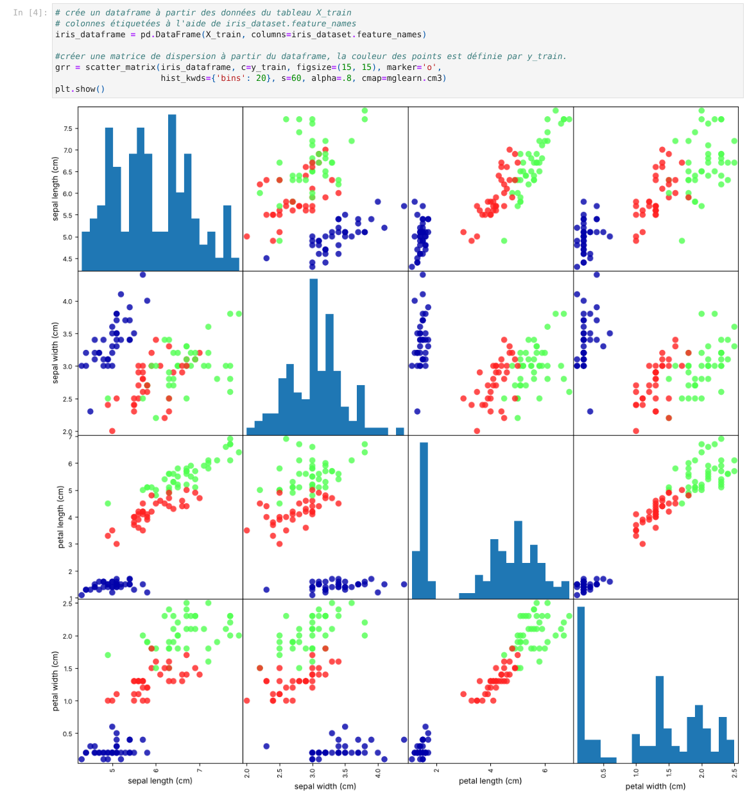
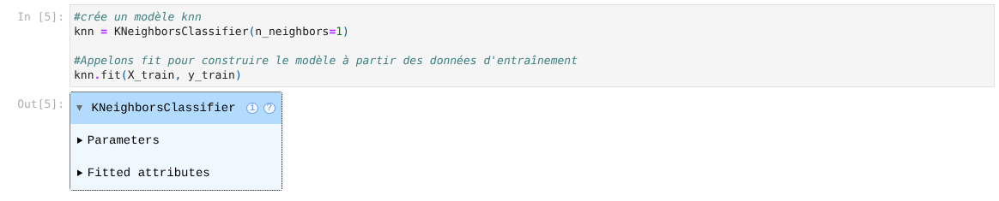
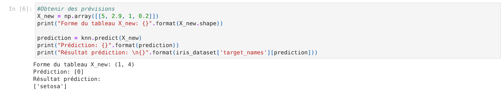
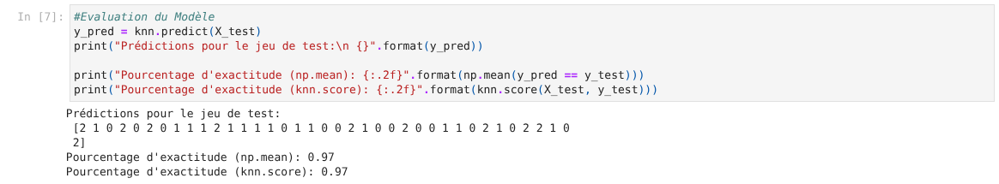
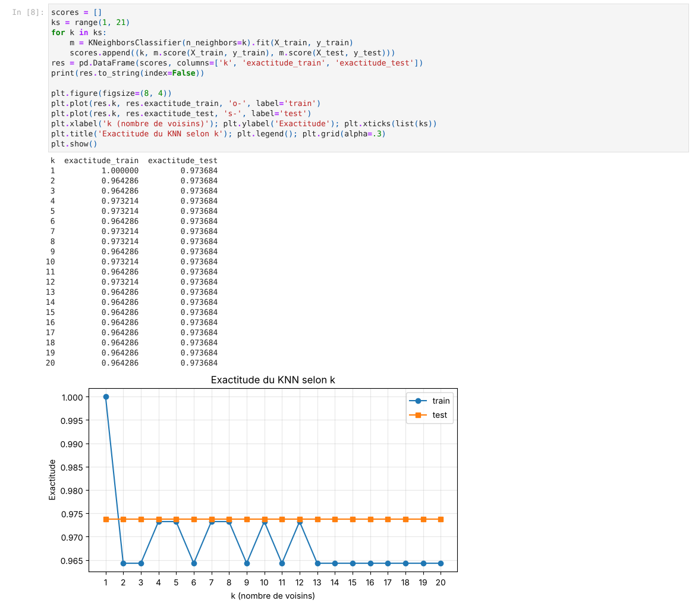

### TP2 : Régression linéaire
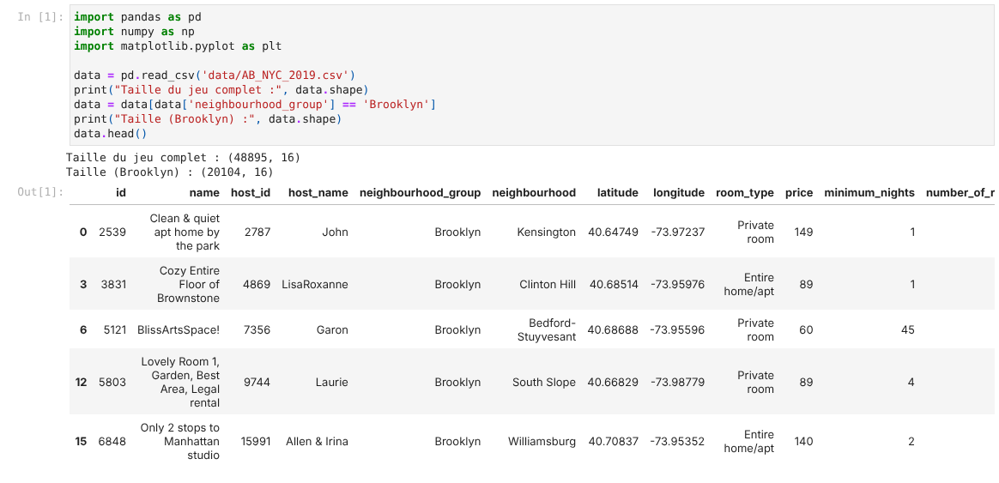
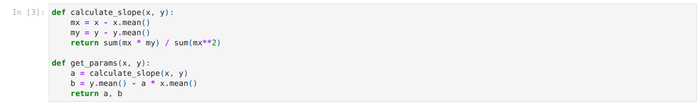
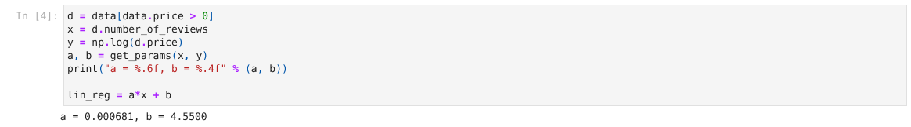
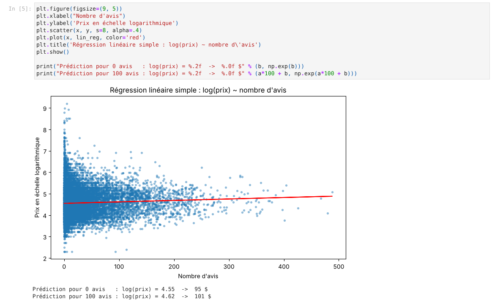
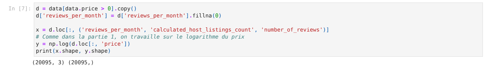
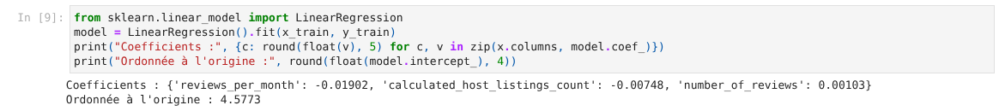
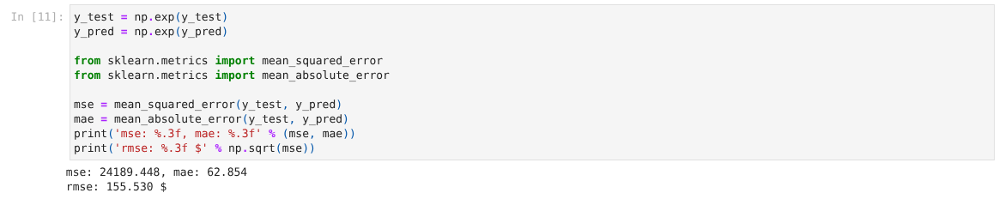
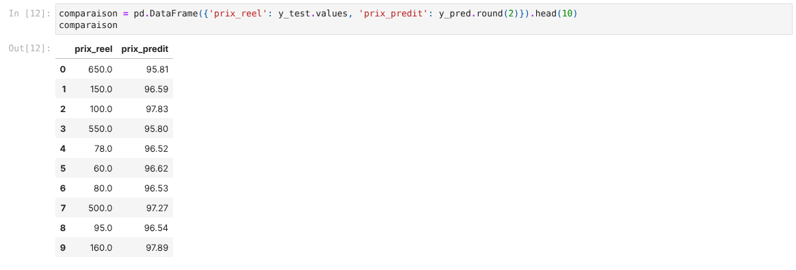
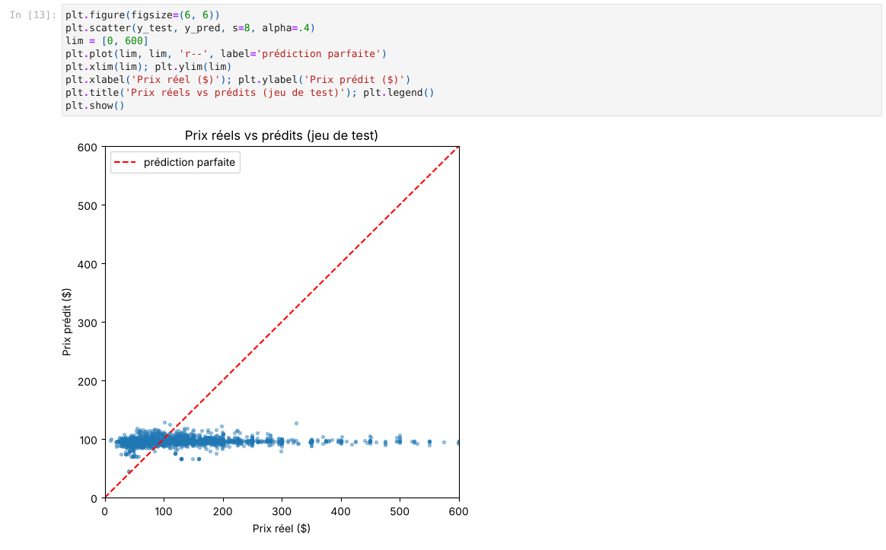
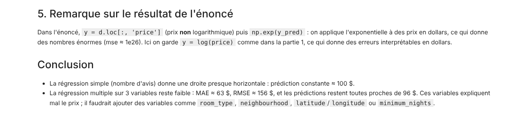

## Remarque sur le TP2

Dans l'énoncé, la régression multiple utilise `y = price` (sans logarithme) puis applique `np.exp` aux prédictions. On obtient alors des erreurs absurdes (mse ≈ 1e26). Ce notebook garde `y = log(price)`, comme dans la première partie, ce qui donne des erreurs exprimées en dollars. La formule correcte de l'ordonnée à l'origine est `b = ȳ − a·x̄`.
