# TP3 : Cartes auto-organisatrices de Kohonen (SOM)

Le TP a été exécuté dans **Anaconda + Jupyter Notebook**, sous Docker (image officielle `continuumio/anaconda3`, Python 3.12.7, numpy 1.26.4, matplotlib 3.9.2). Les cellules ont été lancées depuis l'interface Jupyter avec *Run ▸ Run All Cells*. Les captures ci-dessous montrent cette exécution réelle.

## Contenu

| Fichier | Rôle |
|---|---|
| `notebooks/TP3_Kohonen_SOM.ipynb` | Notebook du TP, exécuté, avec ses sorties |
| `notebooks/TP3_Kohonen_SOM.html` | Export HTML du notebook |
| `notebooks/som_kohonen.py` | Module SOM : classe `SOM` et fonction `plot_data_on_map` |
| `notebooks/som_data_on_map.png` | Image enregistrée par `plot_data_on_map` |
| `Dockerfile`, `docker-compose.yml` | Environnement Anaconda + Jupyter Notebook |

> Le module `som_kohonen` utilisé dans l'énoncé n'est ni sur PyPI ni sur GitHub (le repo d'origine renvoie une erreur 404). Il a donc été réécrit en NumPy avec **la même API** : `create`, `fit(random_sampling, n_iter, dist_method)`, `find_maching_nodes`, `get_map_vectors`, `get_umatrix`, `get_component_plane`, `plot_data_on_map`. Le code de l'énoncé tourne sans aucune modification.

## Lancer le TP dans Docker (Anaconda + Jupyter Notebook)

```bash
cd tp3_kohonen_som
docker compose up --build
# puis ouvrir le lien http://127.0.0.1:8888/tree?token=... affiché dans le terminal
```

Sans Docker, dans Anaconda Navigator : *Jupyter Notebook ▸ ouvrir `notebooks/TP3_Kohonen_SOM.ipynb` ▸ Run All*.

## Résultats

- 1000 vecteurs RGB, carte 15×15, 20 itérations, `random_sampling=0.5` : l'entraînement prend environ 0,4 s.
- Erreur de quantification moyenne : **0.2126**.
- La carte range les couleurs de façon continue (noir → vert → cyan → bleu → magenta → jaune → rouge). La U-matrice sépare bien les clusters.

## Captures d'écran (Jupyter Notebook dans le conteneur Anaconda)

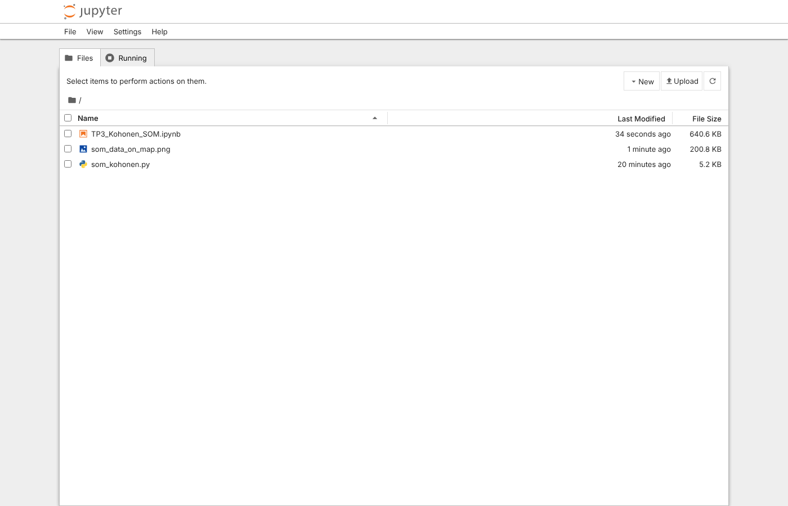
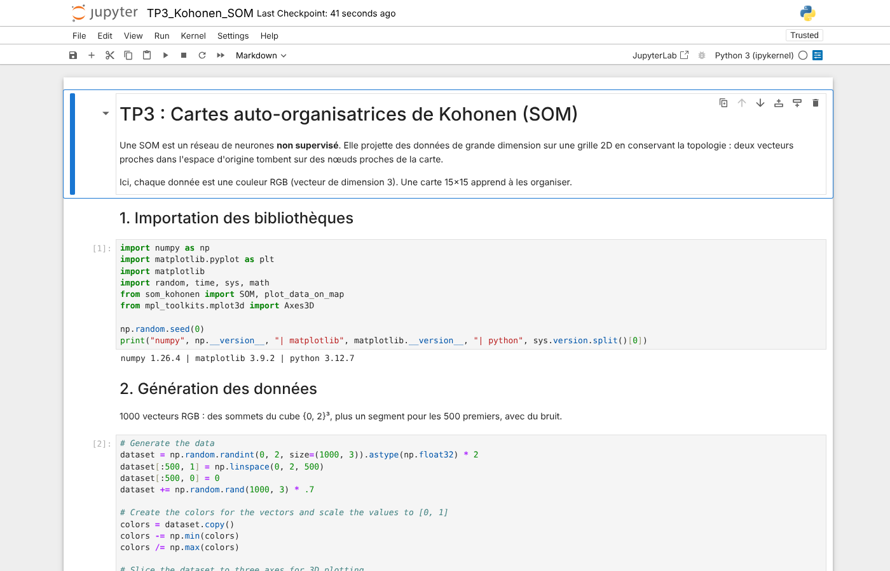
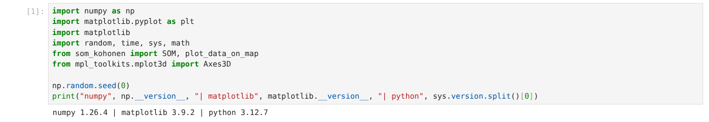
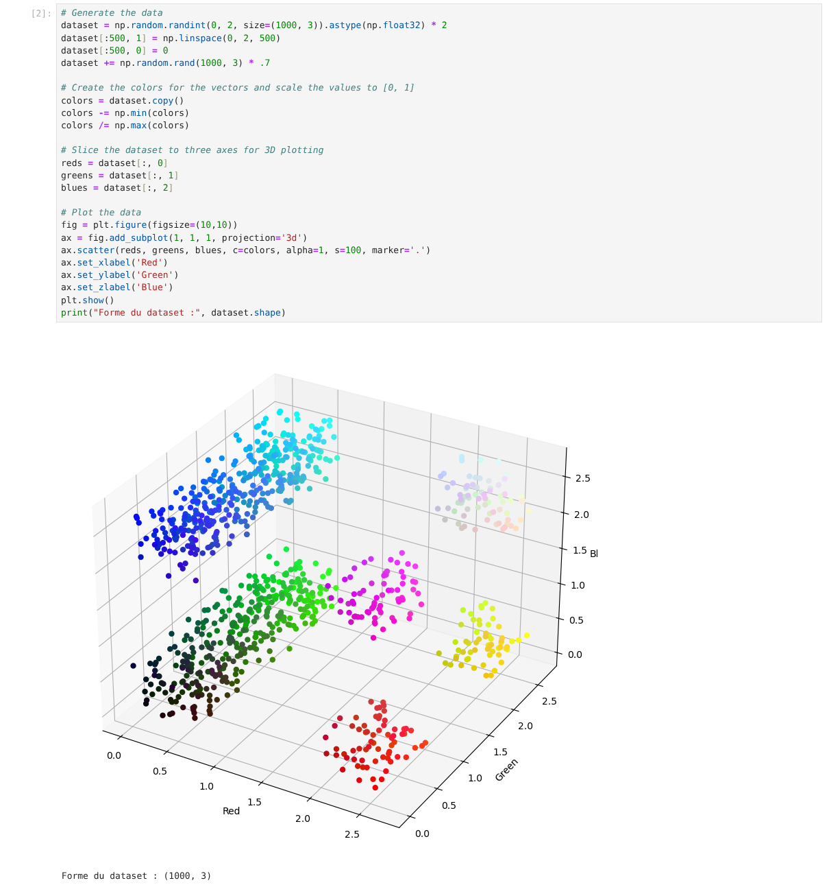
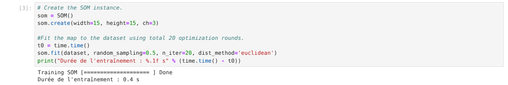
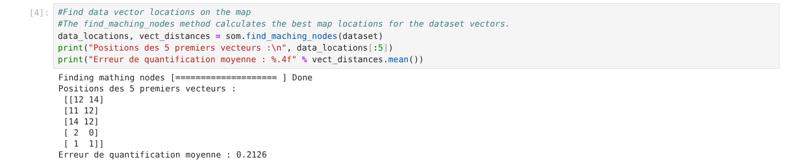
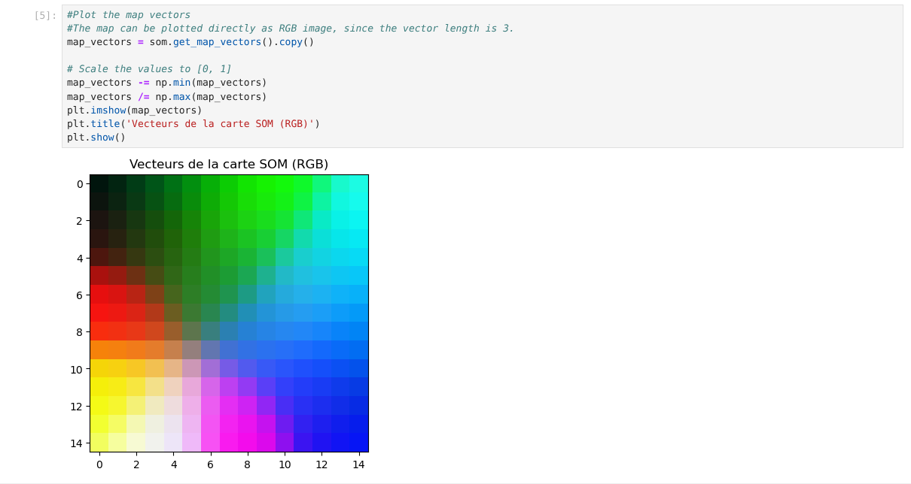
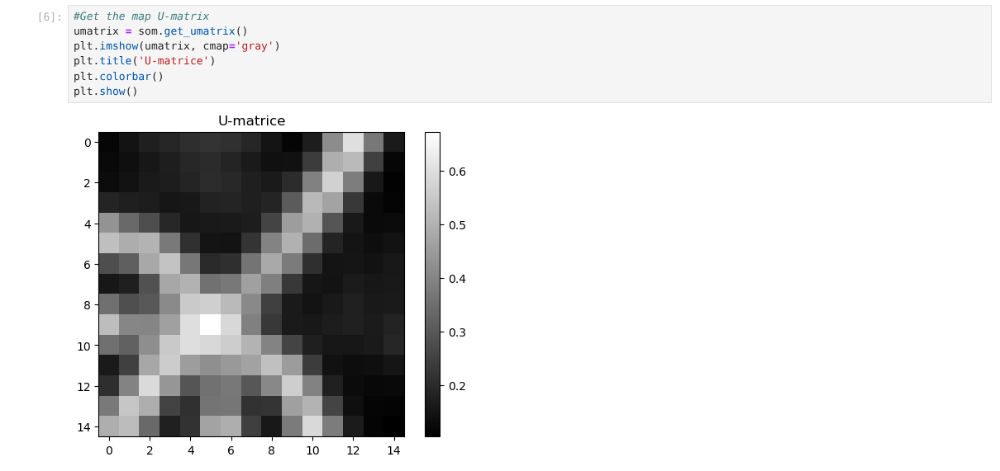
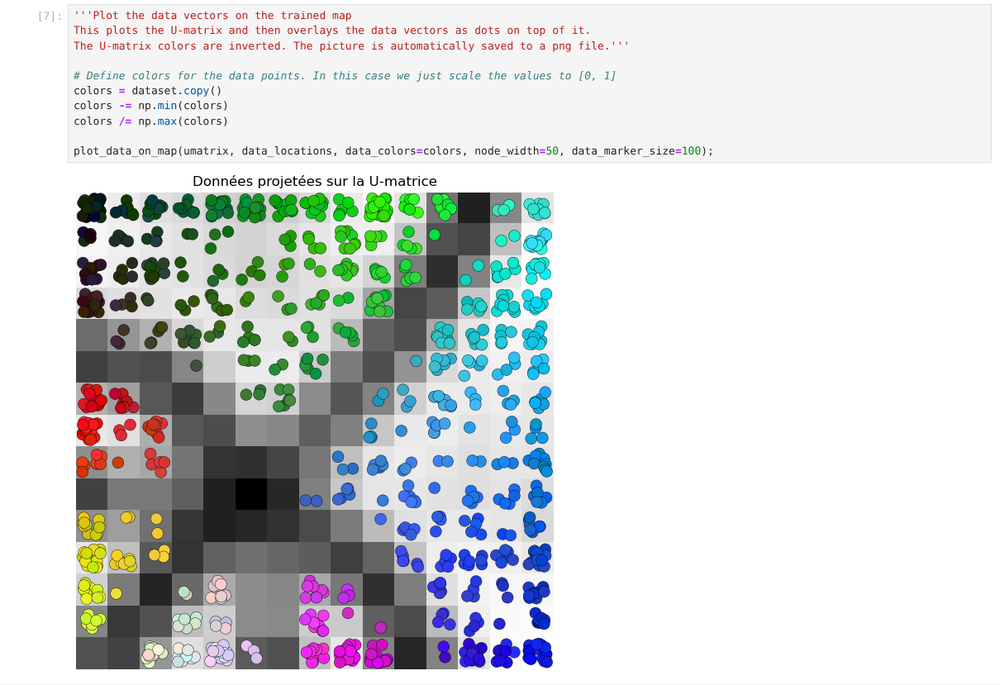
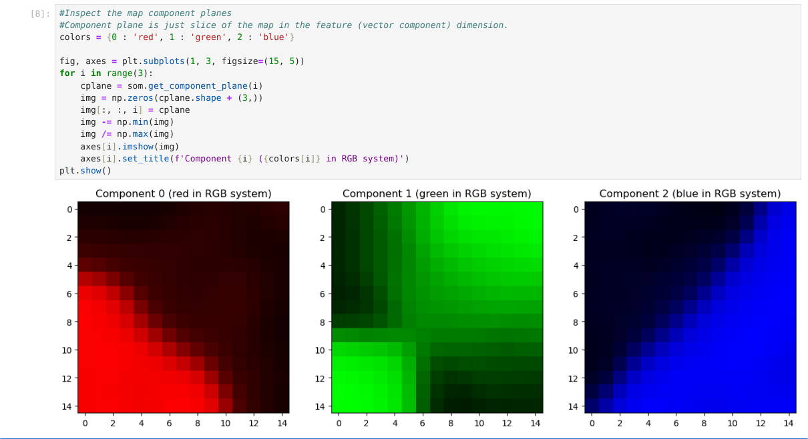
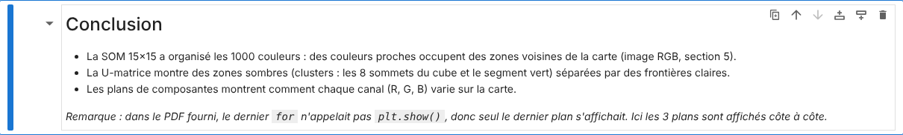
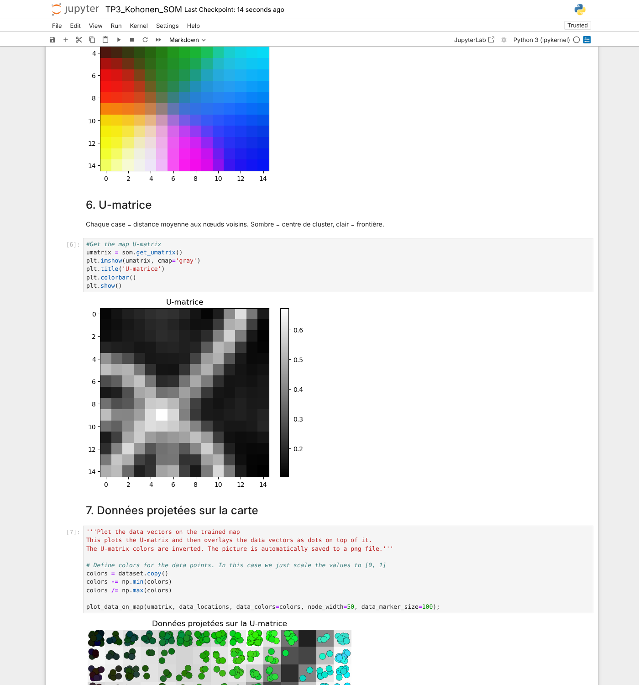
