# TP4 : Régression logistique, diagnostic du cancer du sein

Le TP a été exécuté dans **Anaconda + Jupyter Notebook**, sous Docker (image `continuumio/anaconda3`, scikit-learn 1.5.1). Les cellules ont été lancées depuis l'interface Jupyter avec *Run ▸ Run All Cells*.

Les données viennent de Kaggle, *Breast Cancer Wisconsin (Diagnostic)* : `notebooks/data.csv`, 569 patients × 33 colonnes (357 bénins, 212 malins).

## Étapes

1. Chargement des données, puis `.head()`, `.info()` et `.isnull().sum()`.
2. Suppression des colonnes `id` et `Unnamed: 32` avec `drop`.
3. Encodage de `diagnosis` : M → 1, B → 0.
4. Séparation train / test (80 / 20, stratifiée), puis standardisation (`StandardScaler`).
5. Entraînement d'une `LogisticRegression`.
6. Évaluation : exactitude, rapport de classification, matrice de confusion, courbe ROC, coefficients.

## Résultats (jeu de test, 114 patients)

| Mesure | Valeur |
|---|---|
| Exactitude (train) | 0.9868 |
| **Exactitude (test)** | **0.9649** |
| AUC ROC | 0.996 |
| Matrice de confusion | `[[71 1] [3 39]]` : 1 faux positif, 3 faux négatifs |
| Rappel « maligne » | 0.93 |

> Dans l'énoncé, le fichier est chargé avec `pd.read_csv(r"c:\data.csv")`. Ici, `data.csv` est placé à côté du notebook et chargé avec `pd.read_csv("data.csv")`. Sur ton PC, garde l'un ou l'autre selon l'endroit où se trouve le fichier.

## Lancer

```bash
cd tp4_regression_logistique
docker compose up --build
# ouvrir le lien http://127.0.0.1:8888/tree?token=... affiché, puis TP4_Regression_Logistique.ipynb
```

## Captures d'écran (Jupyter Notebook dans le conteneur Anaconda)

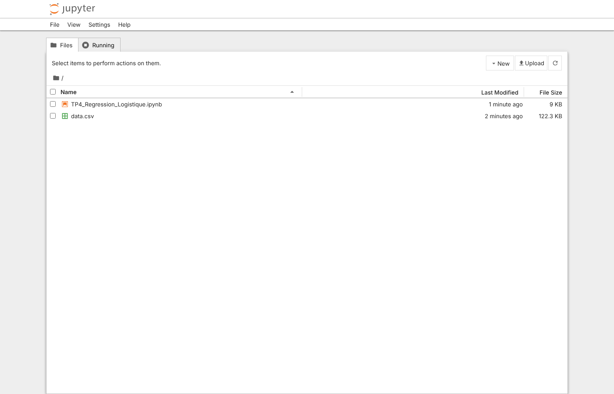
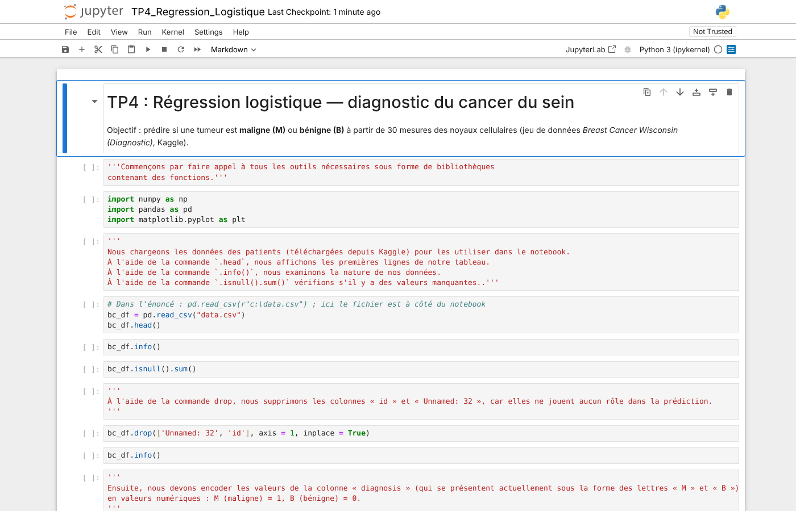

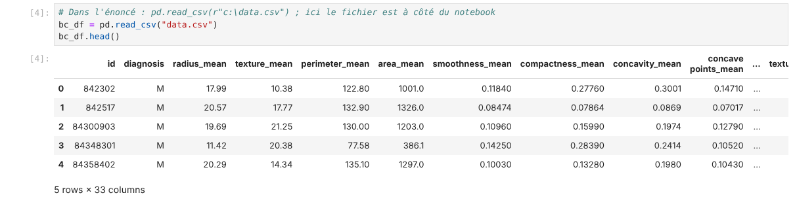
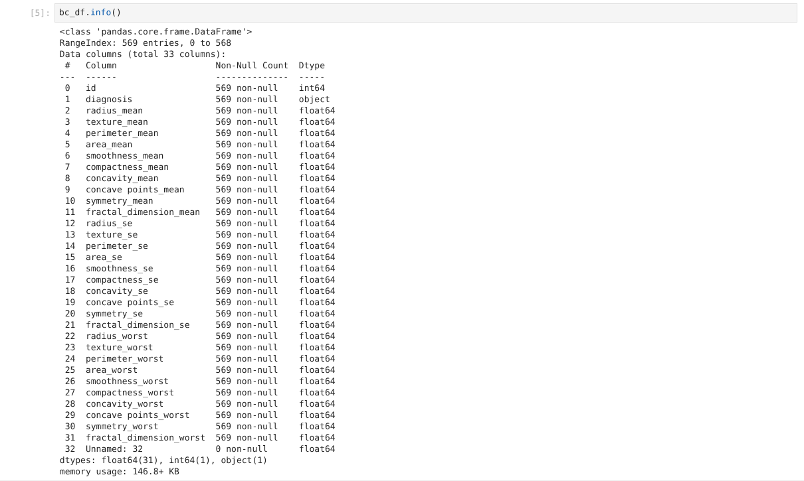
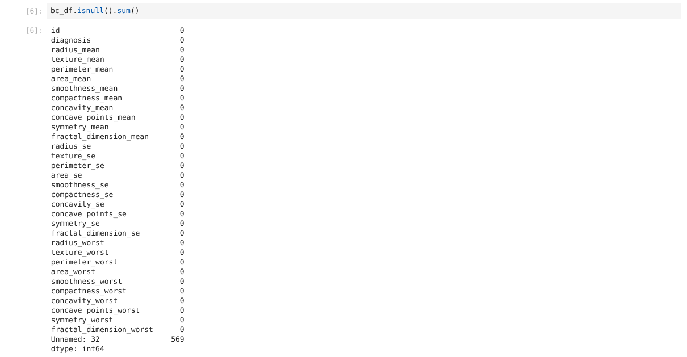

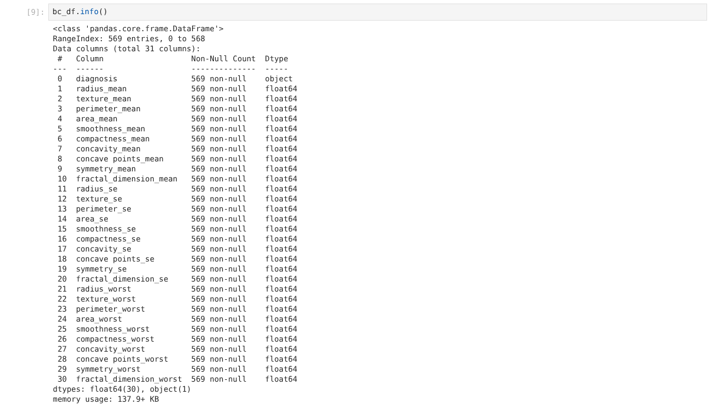
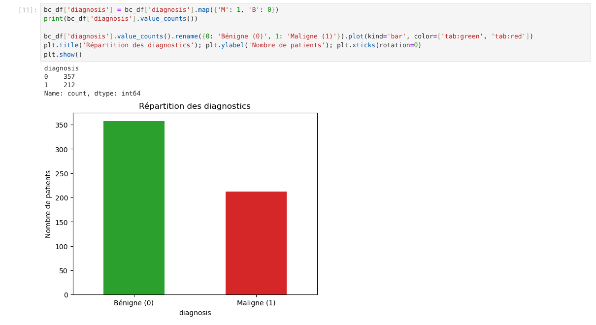
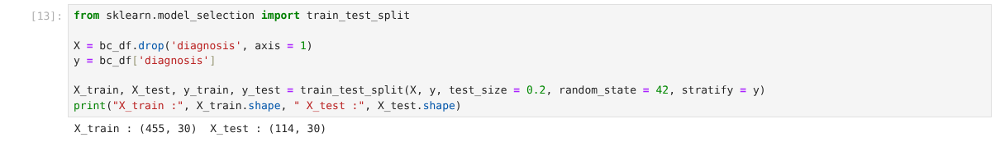
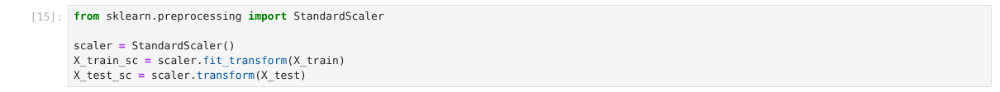
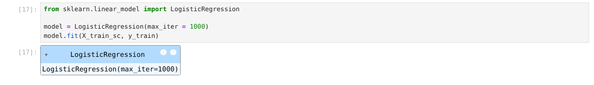
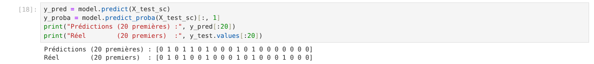
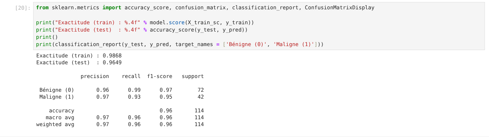
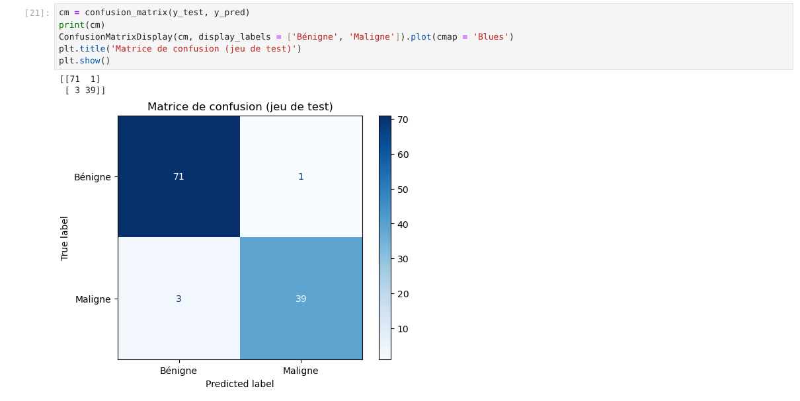
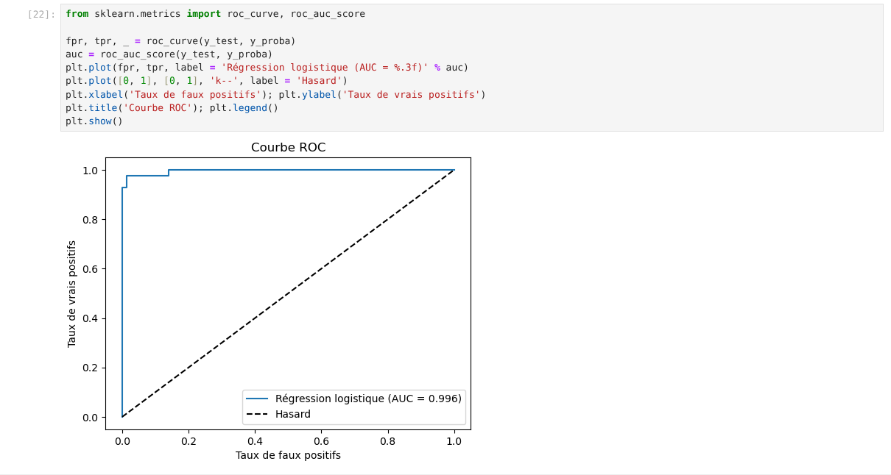
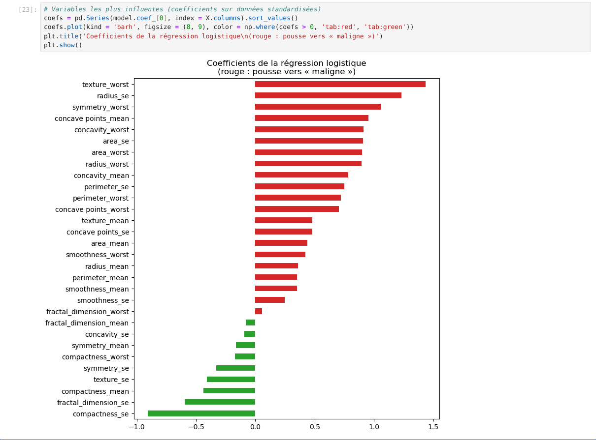
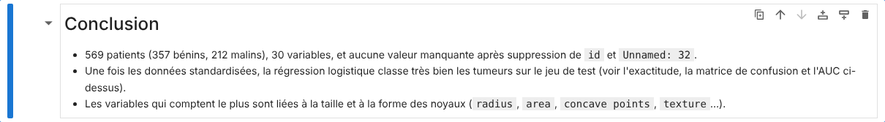
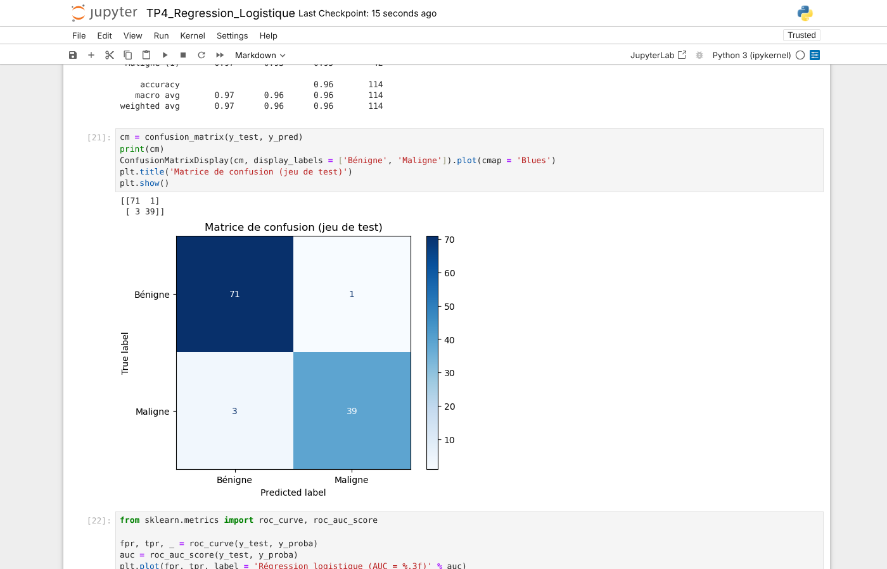
